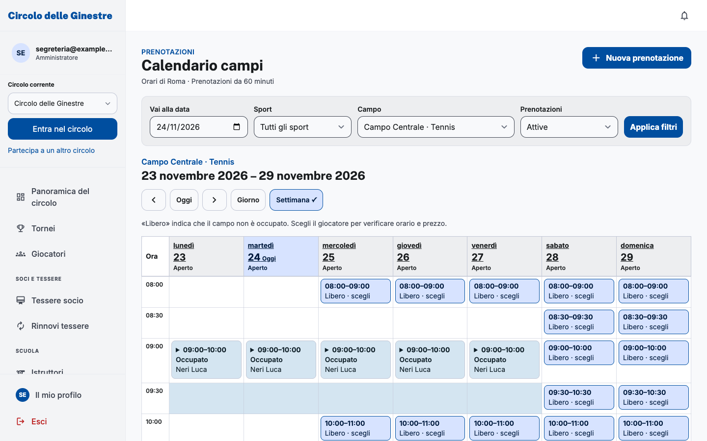
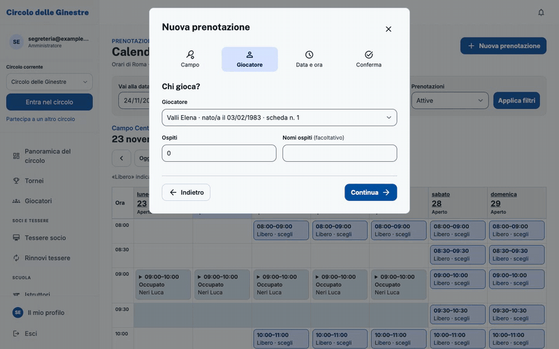

<p></p>

# CircoloManager

CircoloManager brings court bookings, memberships and tennis school operations together for a sports club's front desk. Follow the work of a receptionist through an ordinary club day, or read how the underlying application handles the cases that make a busy day difficult.

[English website source](site/index.html) · [Sito in italiano](site/it/index.html) · [Case study source](site/case-study/index.html) · [Request a personal walkthrough on LinkedIn](https://www.linkedin.com/in/lorenzobacci96/)



## At the desk

| Task | What the operator can do |
| --- | --- |
| Book a court | Check the calendar and available slots, confirm a court and revisit the saved reservation. |
| Renew a membership | Find a member, review the next period and fee, confirm and see the updated history. |
| Run a lesson | Open a class register and record attendance for individual players. |
| Follow tournament play | Manage draws and view the progress of club competitions. |
| Review a member's account | Distinguish a charge from a payment and inspect the movements behind the balance. |

The demo uses an isolated installation and a fictional club. The product interface in the recording is in Italian. The presentation website supplies English and Italian descriptions.

<details>
<summary>Show the 12-second animated excerpt</summary>

[](site/assets/media/walkthrough.mp4)

</details>

[Download the full walkthrough](site/assets/media/walkthrough.mp4) or use the video player and transcript on either landing page.

## Engineering and maturity

Lorenzo Bacci developed CircoloManager as a personal, proprietary product. The application uses ASP.NET Core MVC on .NET 10, Entity Framework Core, SQL Server, ASP.NET Core Identity and Tailwind CSS. The case study follows two design decisions through to the operator experience, including how access follows the selected club and how staff can find out whether a booking was saved after a connection problem.

A pilot installation exists. The release recorded on 21 November 2026 passed service and system-administrator checks. First-club onboarding and everyday staff workflows on that installation still await operational verification. The portfolio records workflows exercised in the isolated environment. [Read the verification summary](docs/verification.md).

## Preview and publication

Run the portfolio locally from this repository with Python 3 and Git:

```sh
python3 scripts/build.py --verify-tree
python3 scripts/preview.py
```

Planned hosted pages include the [CircoloManager portfolio](https://lorenzobacci20.github.io/circolomanager-showcase/) and its [engineering case study](https://lorenzobacci20.github.io/circolomanager-showcase/case-study/). The initial candidate is prepared for owner review. [See the publication procedure](docs/publication.md).

## Ownership

CircoloManager is proprietary software. This repository contains only public showcase materials and the presentation website. The application source code, business logic and production infrastructure are not distributed.

© 2026 Lorenzo Bacci. [Rights and attribution](RIGHTS.md).
